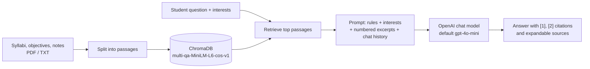

# SuccessGuideAI

**A study and career advisor that answers from your own course materials, and shows where each answer comes from.**

Students upload a syllabus, learning objectives or lecture notes and ask questions such as *"How can I do well in this course?"* or *"Which careers fit my interest in design and teaching?"*. SuccessGuideAI finds the relevant passages in those files, gives them to a large language model together with the student's interests, and returns a short answer that cites its sources ([1], [2], …). The sources are shown under each answer, so the student can check them.

## Why this project

Students often ask general chatbots for study advice, but the answers are not connected to their actual course: its objectives, assessments and reading list. SuccessGuideAI grounds the advice in the course documents themselves and is explicit when it has to fall back to general advice. The system prompt also asks the model to *support* the student's own decisions rather than make them, which reflects my interest in AI that supports learner autonomy.

It was built during **CEIT 490: Developing Educational Applications Using Large Language Models** at Middle East Technical University (2025) and rebuilt in 2026 with a cleaner structure, source citations, safe API-key handling and tests.

## How it works



- **`guide/store.py`**: reads PDF/TXT files, splits them into passages of about 900 characters and stores them in ChromaDB with a question-answering embedding model. Uploading the same file again replaces it instead of duplicating it.
- **`guide/assistant.py`**: retrieves the passages most related to the question and the student's interests, builds the prompt and keeps a short conversation history, so follow-up questions work.
- **`app.py`**: the Streamlit chat interface.

## Run it

Requires Python 3.10+ and an [OpenAI API key](https://platform.openai.com/api-keys).

```bash
git clone https://github.com/tugceunlu/SuccessGuide.git
cd SuccessGuide
python -m venv .venv && source .venv/bin/activate
pip install -r requirements.txt
export OPENAI_API_KEY="sk-..."      # or paste it into the sidebar
streamlit run app.py
```

The key is read from the `OPENAI_API_KEY` environment variable, from `.streamlit/secrets.toml` (ignored by git), or from a password field in the sidebar. It is never written into the code. You can choose a different model in the sidebar or with `SUCCESSGUIDE_MODEL`.

Click **Load sample materials** to try it with three short course-note files from `sample_materials/`.

## Tests

```bash
pytest
```

The tests use a fake chat model, so they run without an API key. They check that uploads are not duplicated, that retrieval finds the matching course, that the assistant passes sources and keeps the conversation history, and that it says so when no materials are uploaded.

## Project structure

```
app.py                Streamlit chat interface
guide/
  store.py            reading, splitting and searching course materials
  assistant.py        prompt, retrieval-augmented answers and chat history
sample_materials/     example course notes
tests/                pytest tests
```

## Limitations and next steps

- Answers depend on an external model (OpenAI), so course materials are sent to that provider. For real courses, an option for a local or institution-hosted model would be better for privacy.
- Career suggestions come from the model's general knowledge, not from labour-market data.
- It has not been evaluated with students yet. A useful next step would be to compare students' trust in grounded, cited answers with uncited ones.

## Author

Built by **Tuğçe Müller** (formerly Ünlü), instructional technologist and incoming M.A. student in Adult Education at Julius-Maximilians-Universität Würzburg. My research interest is generative AI in adult and lifelong learning.
[Website](https://tugceunlu.github.io) · [LinkedIn](https://www.linkedin.com/in/tugceunlu2023)
